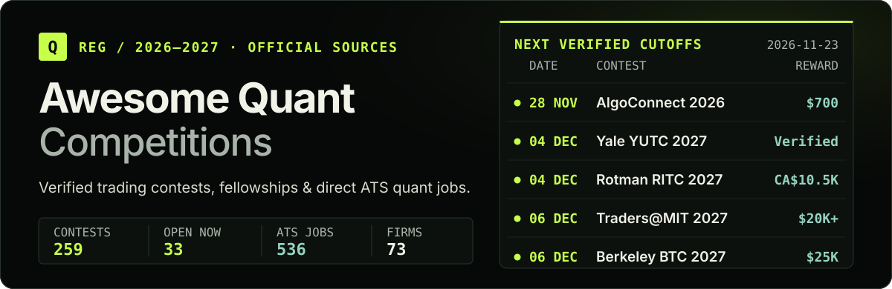
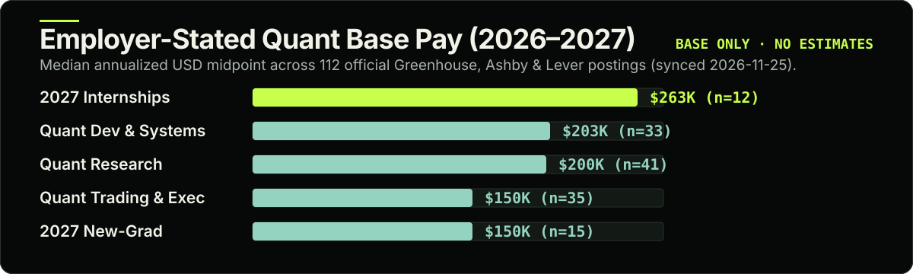
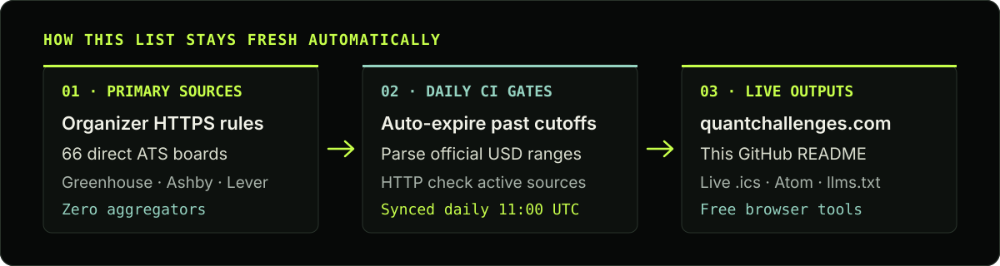

  

  <a href="https://quantchallenges.com/challenges/open"><strong>Open Competitions (41)</strong></a>
  &nbsp;·&nbsp;
  <a href="https://calendar.google.com/calendar/render?cid=webcal://quantchallenges.com/challenges/calendar.ics"><strong>Add .ics to Google Calendar</strong></a>
  &nbsp;·&nbsp;
  <a href="https://quantchallenges.com/tools/quant-interview-drills"><strong>80-in-8 &amp; MM Drills</strong></a>
  &nbsp;·&nbsp;
  <a href="https://quantchallenges.com/jobs"><strong>Direct ATS Jobs (552)</strong></a>
  &nbsp;·&nbsp;
  <a href="https://quantchallenges.com/reports/state-of-quant-2026-2027"><strong>2026–2027 Pay Report</strong></a>

An official-source, daily-verified directory for **quantitative trading competitions**, **financial ML benchmarks**, **student fellowships**, **free interview drills**, and **direct-employer ATS quant openings** (2026–2027). Every competition links straight to organizer HTTPS rules; every live job is parsed directly from Greenhouse, Ashby, or Lever with zero fabricated salary estimates.

---

## Live Proof: Employer-Stated Quant Base Pay

  

Filter every individual USD base salary range interactively in the **[Quant Base-Pay Explorer & Kelly/Sharpe Calculator](https://quantchallenges.com/tools/quant-comp-and-kelly)** or read the full **[State of Quant Competitions & Hiring 2026–2027 Report](https://quantchallenges.com/reports/state-of-quant-2026-2027)**.

---

## Start in 30 Seconds

1. **Never miss a deadline:** [Add the live `.ics` calendar to Google Calendar](https://calendar.google.com/calendar/render?cid=webcal://quantchallenges.com/challenges/calendar.ics), open in [Apple / Outlook](webcal://quantchallenges.com/challenges/calendar.ics), or follow the [Atom/RSS feed](https://quantchallenges.com/challenges/feed.xml).
2. **Pick an active competition below:** enter a dated student/global contest or a weekly recurring alpha tournament.
3. **Train for prop-firm screens free:** launch the browser-based [Optiver 80-in-8 mental math sprint, market-making simulator & 16 probability proofs](https://quantchallenges.com/tools/quant-interview-drills).

---

  

### Upcoming Dated Competitions (Accepting Entries)

| Competition | Organizer | Cutoff | Stated Reward | Source |
| --- | --- | --- | --- | --- |
| [AlgoConnect Quantathon 2026](https://quantchallenges.com/challenges/algoconnect-quantathon-2026-qc-2960) | AlgoConnect × QUARCC | `2026-11-28` | $700 cash first-place prize | [Rules](https://algoconnect-quantathon-2026.devpost.com/) |
| [Конкурс аналитиков 2026](https://quantchallenges.com/challenges/2026-qc-2883) | Invest-idei.ru / Moscow Exchange | `2026-11-30` | ₽900,000 distributed monthly for six months:… | [Rules](https://konkurs2026.invest-idei.ru/) |
| [Lancaster Financial Econometrics Prize - FINEC2027](https://quantchallenges.com/challenges/lancaster-financial-econometrics-prize-finec2027-qc-2888) | Lancaster University… | `2026-12-01` | GBP 1,000 best-paper prize | [Rules](https://wp.lancs.ac.uk/finec2027/) |
| [Yale Undergraduate Trading Competition 2027 (YUTC)](https://quantchallenges.com/challenges/yale-undergraduate-trading-competition-2027-yutc-qc-2955) | Yale Undergraduate Trading… | `2026-12-04` | Travel reimbursed, hotel arranged and… | [Rules](https://yutc.org/) |
| [Rotman International Trading Competition 2027](https://quantchallenges.com/challenges/rotman-international-trading-competition-2027-qc-2731) | Rotman School of Management /… | `2026-12-04` | $10,500 CAD total cash prize pool | [Rules](https://www.rotman.utoronto.ca/faculty-and-research/education-labs/bmo-financial-group-finance-research-and-trading-lab/rotman-international-trading-competition/) |
| [Traders@MIT 19th Annual Trading Competition…](https://quantchallenges.com/challenges/traders-mit-19th-annual-trading-competition-spring-2027-qc-2953) | Traders@MIT | `2026-12-06` | $20,000+ USD prize pool | [Rules](https://traders.mit.edu/competition) |
| [Berkeley Trading Competition 2027 (BTC)](https://quantchallenges.com/challenges/berkeley-trading-competition-2027-btc-qc-2954) | Traders at Berkeley | `2026-12-06` | $25,000 cash prize pool | [Rules](https://traders.studentorg.berkeley.edu/competition/) |
| [Metaculus Market Pulse Challenge 26Q4](https://quantchallenges.com/challenges/metaculus-market-pulse-challenge-26q4-qc-2961) | Metaculus | `2026-12-21` | $7,500 prize pool | [Rules](https://www.metaculus.com/tournament/market-pulse-26q4/) |
| [Quantpedia Awards 2027](https://quantchallenges.com/challenges/quantpedia-awards-2027-qc-2959) | Quantpedia | `2026-12-31` | $25,000 total prize pool | [Rules](https://quantpedia.com/quantpedia-awards-2027/) |
| [Citadel EQR PhD Fellowship](https://quantchallenges.com/challenges/citadel-eqr-phd-fellowship-qc-2972) | Citadel | `2026-12-31` | $150,000 grant per fellow (2 fellowships… | [Rules](https://www.citadel.com/careers/programs-and-events/eqr-phd-fellowship/) |
| [Metaculus Cup Fall 2026](https://quantchallenges.com/challenges/metaculus-cup-fall-2026-qc-2933) | Metaculus | `2027-01-01` | $5,000 prize pool | [Rules](https://www.metaculus.com/tournament/metaculus-cup-fall-2026/) |
| [Right! said FRED: Q4 2026 Finance and Economics…](https://quantchallenges.com/challenges/right-said-fred-q4-2026-finance-and-economics-challenge-qc-2952) | Good Judgment Open | `2027-01-01` | Special GJO badges for top three qualifying… | [Rules](https://www.gjopen.com/challenges/144-right-said-fred-q4-2026-finance-and-economics-challenge) |
| [Fall 2026 FutureEval Bot Tournament](https://quantchallenges.com/challenges/fall-2026-futureeval-bot-tournament-qc-2934) | Metaculus / FutureEval | `2027-01-06` | $50,000 prize pool | [Rules](https://www.metaculus.com/tournament/fall-futureeval-2026/) |
| [Citadel Datathons](https://quantchallenges.com/challenges/citadel-datathons-qc-2735) | Citadel / Citadel Securities /… | `2027-01-11` | Cash prize and eligibility to interview with… | [Rules](https://www.citadel.com/careers/programs-and-events/datathons/) |
| [Discover Citadel & Citadel Securities 2027](https://quantchallenges.com/challenges/discover-citadel-and-citadel-securities-2027-qc-2974) | Citadel × Citadel Securities | `2027-01-29` | All-expenses-paid two-day quant & trading… | [Rules](https://www.citadel.com/careers/programs-and-events/discover-citadel/) |
| [Artificial Intelligence in 2026 and Beyond](https://quantchallenges.com/challenges/artificial-intelligence-in-2026-and-beyond-qc-2971) | Good Judgment Open | `2027-02-01` | Good Judgment Open leaderboard rankings &… | [Rules](https://www.gjopen.com/challenges/133-artificial-intelligence-in-2026-and-beyond) |
| [2027 Stevens High Frequency Trading Competition](https://quantchallenges.com/challenges/2027-stevens-high-frequency-trading-competition-qc-2951) | Stevens Institute of Technology | `2027-02-15` | $4,800 total prize pool | [Rules](https://fsc.stevens.edu/hftc/) |
| [Citadel Securities Quant Invitational](https://quantchallenges.com/challenges/citadel-securities-quant-invitational-qc-2722) | Citadel Securities | `2027-02-25` | $10,000 prize + all-expenses-paid London week | [Rules](https://www.citadelsecurities.com/careers/programs-and-events/the-citadel-securities-quant-invitational/) |
| [Iran & Energy Challenge](https://quantchallenges.com/challenges/iran-and-energy-challenge-qc-2970) | Good Judgment Open | `2027-07-01` | Good Judgment Open leaderboard rankings &… | [Rules](https://www.gjopen.com/challenges/137-iran-energy-challenge) |
| [The Economist: The World Ahead 2027](https://quantchallenges.com/challenges/the-economist-the-world-ahead-2027-qc-2966) | Good Judgment Open / The… | `2027-10-03` | Leaderboard recognition & Superforecaster… | [Rules](https://www.gjopen.com/challenges/150-the-economist-the-world-ahead-2027) |
| [A Challenge of Interest — 2027](https://quantchallenges.com/challenges/a-challenge-of-interest-2027-qc-2964) | Good Judgment Open | `2028-01-01` | Good Judgment Open leaderboard rankings &… | [Rules](https://www.gjopen.com/challenges/149-a-challenge-of-interest-2027) |
| [Global Economics: Purchasing Managers' Indices…](https://quantchallenges.com/challenges/global-economics-purchasing-managers-indices-challenge-qc-2965) | Good Judgment Open | `2028-01-01` | Good Judgment Open rankings &… | [Rules](https://www.gjopen.com/challenges/142-global-economics-purchasing-managers-indices-challenge) |

Full chronological schedule & club embed snippet: **[quantchallenges.com/challenges/calendar](https://quantchallenges.com/challenges/calendar)**

### Year-Round Recurring Quant & Financial ML Platforms

| Platform | Organizer | Cadence | Stated Reward | Source |
| --- | --- | --- | --- | --- |
| [ADIA Lab Structural Break Challenge: Real-Time…](https://quantchallenges.com/challenges/adia-lab-structural-break-challenge-real-time-edition-qc-2969) | ADIA Lab / CrunchDAO | Live real-time monitoring phase… | 100,000 USDC prize pool | [Rules](https://hub.crunchdao.com/competitions/structural-break-real-time) |
| [ADIA Lab Structural Break Open Benchmark Challenge](https://quantchallenges.com/challenges/adia-lab-structural-break-open-benchmark-challenge-qc-2823) | ADIA Lab / CrunchDAO | Continuous quarterly benchmark… | $3,000/$2,000/$1,000 USD per quarter; only… | [Rules](https://docs.crunchdao.com/competitions/competitions/structural-break-open-benchmark) |
| [AI4Finance Open Trading Challenge](https://quantchallenges.com/challenges/ai4finance-open-trading-challenge-qc-2714) | AI4Finance Foundation | rolling / pilot quarter | $3,500 / $1,000 / $500 prizes | [Rules](https://ai4finance.org/competition) |
| [ALGOGENE Global Algo Challenge](https://quantchallenges.com/challenges/algogene-global-algo-challenge-qc-2710) | ALGOGENE | varies by contest | Official contest page advertises cash… | [Rules](https://algogene.com/contest) |
| [AlphaNova Biweekly Season 1](https://quantchallenges.com/challenges/alphanova-biweekly-season-1-qc-2601) | AlphaNova Capital | Two-week submission cycles | Up to $2,500 + carry-over per cycle | [Rules](https://www.alphanova.tech/competition) |
| [DataCrunch Competition](https://quantchallenges.com/challenges/datacrunch-competition-qc-2835) | CrunchDAO / DataCrunch | Weekly · Fri 20:00 – Tue 12:00 UTC | Rewards distributed monthly: 60,000 USDC… | [Rules](https://docs.crunchdao.com/competitions/competitions/datacrunch-competition) |
| [DataCrunch Equity Market Neutral #2](https://quantchallenges.com/challenges/datacrunch-equity-market-neutral-2-qc-2608) | DataCrunch × CrunchDAO | Sun · 12:00 UTC | 1,000 USDC weekly pool | [Rules](https://docs.crunchdao.com/competitions/competitions/datacrunch-2) |
| [Duke FinTech Trading Competition](https://quantchallenges.com/challenges/duke-fintech-trading-competition-qc-2924) | Duke FinTech / Gothic Hedge… | Continual rolling signup | No cash prize listed; recognition through… | [Rules](https://fintechtradingcompetition.com/) |
| [G-Research Spring into Quant Finance](https://quantchallenges.com/challenges/g-research-spring-into-quant-finance-qc-2957) | G-Research | Spring 2027 applications open… | Fully funded week-long residential quant… | [Rules](https://www.gresearch.com/spring-into-quant-finance/) |
| [Global Quant Trading Challenge](https://quantchallenges.com/challenges/global-quant-trading-challenge-qc-2818) | ALGOGENE FINTECH CO. LTD. | Rolling / see rules | Funded capital plans of… | [Rules](https://algogene.com/contest/quant) |
| [Jane Street Quant Programs & Fellowships (FTTP,…](https://quantchallenges.com/challenges/jane-street-quant-programs-and-fellowships-fttp-amp-grf-qc-2956) | Jane Street | Multiple annual cohorts (FTTP,… | Paid immersion programs, stipends and… | [Rules](https://www.janestreet.com/join-jane-street/programs-and-events/) |
| [League of Algo Challenge](https://quantchallenges.com/challenges/league-of-algo-challenge-qc-2832) | ALGOGENE FINTECH CO. LTD. | Rolling / see rules | Top qualified algorithms may engage… | [Rules](https://algogene.com/contest/league) |
| [Metaculus Forecasting Tournaments](https://quantchallenges.com/challenges/metaculus-forecasting-tournaments-qc-2707) | Metaculus | Varies by tournament | Varies by tournament; some list cash prize… | [Rules](https://www.metaculus.com/tournaments/) |
| [Numerai Signals](https://quantchallenges.com/challenges/numerai-signals-qc-2610) | Numerai | Weekly rounds | NMR reward / burn risk | [Rules](https://signals.numer.ai/) |
| [Numerai Tournament](https://quantchallenges.com/challenges/numerai-tournament-qc-2609) | Numerai | Weekly rounds | Performance-based NMR | [Rules](https://forum.numer.ai/t/numerai-v5-3-quantum-data-release/8321) |
| [Optiver Student Programs — FutureFocus & Career…](https://quantchallenges.com/challenges/optiver-student-programs-futurefocus-and-career-kickstarter-2027-qc-2967) | Optiver | Rolling 2027 cohorts (Amsterdam,… | Funded multi-day educational trading/quant… | [Rules](https://www.optiver.com/join-us/students/) |
| [Predictoor Data Farming](https://quantchallenges.com/challenges/predictoor-data-farming-qc-2845) | Ocean Protocol | Rolling / see rules | 100 USDC weekly DF pool distributed pro rata… | [Rules](https://docs.oceanprotocol.com/data-farming/predictoordf) |
| [Quantiacs Contests](https://quantchallenges.com/challenges/quantiacs-contests-qc-2611) | Quantiacs | Varies by contest | Capital + profit share | [Rules](https://quantiacs.com/contest) |
| [Synth: Synthetic Price Data](https://quantchallenges.com/challenges/synth-synthetic-price-data-qc-2612) | CrunchDAO × Synth | Rolling | 30,000 USDC pool and ongoing mining rewards;… | [Rules](https://docs.crunchdao.com/real-time-competitions/competitions/synth/) |

### Flagship Annual Competition Series

Year-independent tracking pages covering past cycles, typical registration windows, and preparation notes:

- **[IMC Prosperity Global Trading Challenge](https://quantchallenges.com/series/imc-prosperity)** — IMC Trading (undefined)
- **[Traders@MIT Annual Trading Competition](https://quantchallenges.com/series/traders-mit)** — Traders@MIT (undefined)
- **[Berkeley Trading Competition (BTC)](https://quantchallenges.com/series/berkeley-btc)** — Traders at Berkeley (undefined)
- **[Yale Undergraduate Trading Competition (YUTC)](https://quantchallenges.com/series/yale-yutc)** — Yale Undergraduate Quantitative Group (undefined)
- **[Stevens High-Frequency Trading Competition (HFTC)](https://quantchallenges.com/series/stevens-hft)** — Stevens Institute of Technology (Hanlon Financial Systems Center) (undefined)
- **[Citadel Securities Trading Invitational](https://quantchallenges.com/series/citadel-trading-invitational)** — Citadel Securities (undefined)
- **[Citadel & Correlation One Datathons](https://quantchallenges.com/series/citadel-datathons)** — Citadel / Citadel Securities / Correlation One (undefined)
- **[Akuna Capital Virtual Quant Trading Challenge](https://quantchallenges.com/series/akuna-quant-challenge)** — Akuna Capital (undefined)
- **[WorldQuant International Quant Championship (IQC) & BRAIN](https://quantchallenges.com/series/worldquant-iqc)** — WorldQuant BRAIN (undefined)
- **[Rotman International Trading Competition (RITC)](https://quantchallenges.com/series/rotman-ritc)** — Rotman School of Management (University of Toronto) (undefined)
- **[UChicago Trading Competition](https://quantchallenges.com/series/uchicago-trading-competition)** — University of Chicago Financial Markets Program (undefined)
- **[Cornell Trading Competition](https://quantchallenges.com/series/cornell-trading-competition)** — Cornell Quant Fund (undefined)
- **[Bloomberg Global Trading Challenge](https://quantchallenges.com/series/bloomberg-global-trading)** — Bloomberg for Education (undefined)
- **[Optiver Ready Trader Go & Financial ML Benchmarks](https://quantchallenges.com/series/optiver-ready-trader-go)** — Optiver (undefined)
- **[Jane Street Forecasting Benchmarks & Student Programs](https://quantchallenges.com/series/jane-street-benchmarks)** — Jane Street (undefined)
- **[Numerai Tournament & Numerai Signals](https://quantchallenges.com/series/numerai-tournaments)** — Numerai (undefined)
- **[CrunchDAO & DataCrunch Equity Benchmarks](https://quantchallenges.com/series/crunchdao-datacrunch)** — CrunchDAO (undefined)
- **[ADIA Lab Structural Break Challenge Series](https://quantchallenges.com/series/adia-lab-structural-break)** — ADIA Lab × CrunchDAO (undefined)
- **[Metaculus Market Pulse & FutureEval Series](https://quantchallenges.com/series/metaculus-tournaments)** — Metaculus (undefined)
- **[Good Judgment Open Macro & Econ Series](https://quantchallenges.com/series/good-judgment-open)** — Good Judgment Open (undefined)
- **[Quantpedia Quantitative Research Awards](https://quantchallenges.com/series/quantpedia-awards)** — Quantpedia (undefined)
- **[AlphaNova Biweekly Residual Alpha Series](https://quantchallenges.com/series/alphanova-biweekly)** — AlphaNova Capital (undefined)
- **[Quantiacs Algorithmic Trading Contests](https://quantchallenges.com/series/quantiacs-contests)** — Quantiacs (undefined)
- **[Imperial College Algothon & Trading Academy](https://quantchallenges.com/series/imperial-algothon)** — Imperial College Algorithmic Trading Society (undefined)
- **[Susquehanna (SIG) Algothon & Predictions Cup](https://quantchallenges.com/series/sig-algothon-and-predictions)** — Susquehanna International Group (SIG) (undefined)

Browse all 25 series: **[quantchallenges.com/series](https://quantchallenges.com/series)**

### Student Fellowships, Spring Weeks & Insight Programs

| Program | Organizer | Window | Terms | Source |
| --- | --- | --- | --- | --- |
| [Jane Street Quant Programs & Fellowships (FTTP,…](https://quantchallenges.com/challenges/jane-street-quant-programs-and-fellowships-fttp-amp-grf-qc-2956) | Jane Street | Seasonal programs | Paid immersion programs, stipends and… | [Rules](https://www.janestreet.com/join-jane-street/programs-and-events/) |
| [G-Research Spring into Quant Finance](https://quantchallenges.com/challenges/g-research-spring-into-quant-finance-qc-2957) | G-Research | Applications open | Fully funded week-long residential quant… | [Rules](https://www.gresearch.com/spring-into-quant-finance/) |
| [Optiver Student Programs — FutureFocus & Career…](https://quantchallenges.com/challenges/optiver-student-programs-futurefocus-and-career-kickstarter-2027-qc-2967) | Optiver | Programs open | Funded multi-day educational trading/quant… | [Rules](https://www.optiver.com/join-us/students/) |
| [Citadel EQR PhD Fellowship](https://quantchallenges.com/challenges/citadel-eqr-phd-fellowship-qc-2972) | Citadel | Applications open | $150,000 grant per fellow (2 fellowships… | [Rules](https://www.citadel.com/careers/programs-and-events/eqr-phd-fellowship/) |
| [Discover Citadel & Citadel Securities 2027](https://quantchallenges.com/challenges/discover-citadel-and-citadel-securities-2027-qc-2974) | Citadel × Citadel… | Applications open | All-expenses-paid two-day quant & trading… | [Rules](https://www.citadel.com/careers/programs-and-events/discover-citadel/) |
| [D.E. Shaw Quantitative & Tech Fellowships](https://quantchallenges.com/challenges/d-e-shaw-quantitative-and-tech-fellowships-qc-2958) | D.E. Shaw | Annual cohorts | Paid educational fellowships with stipends… | [Rules](https://www.deshaw.com/careers/fellowships) |
| [Citadel GQS PhD Fellowship](https://quantchallenges.com/challenges/citadel-gqs-phd-fellowship-qc-2973) | Citadel | Opens 01 Dec | $150,000 grant per fellow (3 fellowships… | [Rules](https://www.citadel.com/careers/programs-and-events/gqs-phd-fellowship/) |

Full fellowships directory: **[quantchallenges.com/challenges/fellowships](https://quantchallenges.com/challenges/fellowships)**

---

## Why This List Doesn't Rot

  

- **No stale "open" badges:** fixed-deadline contests expire automatically once cutoffs pass or source checks age past 45 days.
- **No aggregator middlemen:** every contest links to organizer HTTPS rules and every live job links directly to Greenhouse, Ashby, or Lever.
- **Daily automated sync:** `README.md` and the SVG snapshots refresh automatically from [quantchallenges.com](https://quantchallenges.com) (last synced `2026-11-23`).

---

  

### Free Interactive Quant Tools (No Login)

| Tool | What You Can Do | Link |
| --- | --- | --- |
| **Quant Interview Drills** | Timed Optiver 80-in-8 mental math, 5-round market-making quoting sim, 16 worked probability & martingale proofs | [Launch Drills](https://quantchallenges.com/tools/quant-interview-drills) |
| **Options & Greeks Trainer** | Live Black-Scholes pricer, interactive payoff curve, all 5 Greeks & 14 Optiver/SIG/IMC put-call parity drills | [Open Options Trainer](https://quantchallenges.com/tools/options-greeks-and-parity) |
| **Pay Explorer & Kelly / Sharpe** | Filter 116 live official USD base salary ranges, compute fractional Kelly sizing & backtest Sharpe t-stats | [Open Calculator](https://quantchallenges.com/tools/quant-comp-and-kelly) |
| **State of Quant 2026–2027** | Live benchmark charts for median pay by track/seniority, top 10 hiring cities & visa disclosure | [Read Report](https://quantchallenges.com/reports/state-of-quant-2026-2027) |
| **All Free Quant Tools Hub** | Complete suite of browser calculators, simulators, and live feeds | [View /tools](https://quantchallenges.com/tools) |

### Direct-Employer Quant Firm Hubs (78 Firms)

Each hub combines firm-sponsored competitions, student fellowships, interview playbooks, and live direct-ATS openings:

- **Market Makers & Prop Firms:** [Jane Street](https://quantchallenges.com/firms/jane-street) · [Citadel & Citadel Securities](https://quantchallenges.com/firms/citadel) · [IMC Trading](https://quantchallenges.com/firms/imc-trading) · [Optiver](https://quantchallenges.com/firms/optiver) · [Jump Trading](https://quantchallenges.com/firms/jump-trading) · [Susquehanna International Group (SIG)](https://quantchallenges.com/firms/sig) · [DRW](https://quantchallenges.com/firms/drw) · [Akuna Capital](https://quantchallenges.com/firms/akuna-capital) · [Tower Research Capital](https://quantchallenges.com/firms/tower-research) · [Virtu Financial](https://quantchallenges.com/firms/virtu) · [Flow Traders](https://quantchallenges.com/firms/flow-traders) · [Five Rings](https://quantchallenges.com/firms/five-rings) · [Belvedere Trading](https://quantchallenges.com/firms/belvedere-trading) · [Simplex Trading](https://quantchallenges.com/firms/simplex-trading)
- **Systematic & Multi-Strat Hedge Funds:** [WorldQuant](https://quantchallenges.com/firms/worldquant) · [Point72 & Cubist Systematic](https://quantchallenges.com/firms/point72) · [Qube Research & Technologies (QRT)](https://quantchallenges.com/firms/qrt) · [Squarepoint Capital](https://quantchallenges.com/firms/squarepoint) · [Two Sigma](https://quantchallenges.com/firms/two-sigma) · [Millennium Management](https://quantchallenges.com/firms/millennium) · [AQR Capital Management](https://quantchallenges.com/firms/aqr) · [G-Research](https://quantchallenges.com/firms/g-research) · [D. E. Shaw Group](https://quantchallenges.com/firms/de-shaw) · [Schonfeld Strategic Advisors](https://quantchallenges.com/firms/schonfeld) · [Man Group](https://quantchallenges.com/firms/man-group) · [The Voleon Group](https://quantchallenges.com/firms/voleon) · [PDT Partners](https://quantchallenges.com/firms/pdt-partners) · [Winton](https://quantchallenges.com/firms/winton) · [Engineer's Gate](https://quantchallenges.com/firms/engineers-gate) · [Edgestream Partners](https://quantchallenges.com/firms/edgestream)
- **Digital-Asset, Prediction & Crowdsourced Quant:** [Numerai](https://quantchallenges.com/firms/numerai) · [CrunchDAO](https://quantchallenges.com/firms/crunchdao) · [Wintermute](https://quantchallenges.com/firms/wintermute) · [Kalshi](https://quantchallenges.com/firms/kalshi) · [Polymarket](https://quantchallenges.com/firms/polymarket) · [Flowdesk](https://quantchallenges.com/firms/flowdesk) · [Selini Capital](https://quantchallenges.com/firms/selini-capital) · [Presto Labs](https://quantchallenges.com/firms/presto-labs)

Explore all **78 firm hubs**: **[quantchallenges.com/firms](https://quantchallenges.com/firms)**

### High-Intent Job Hubs & Strategy Playbooks

- **Direct ATS Job Hubs:** [2027 Internships (75)](https://quantchallenges.com/jobs/internships) · [2027 New-Grad](https://quantchallenges.com/jobs/new-grad) · [Disclosed USD Pay (116)](https://quantchallenges.com/jobs/salary-disclosed) · [Visa Sponsorship](https://quantchallenges.com/jobs/visa-sponsorship) · [Remote](https://quantchallenges.com/jobs/remote) · [Quant Researcher](https://quantchallenges.com/jobs/quant-researcher) · [Quant Trader](https://quantchallenges.com/jobs/quant-trader) · [Quant Developer](https://quantchallenges.com/jobs/quant-developer)
- **Editorial Playbooks:** [Jane Street vs Citadel vs Optiver vs IMC](https://quantchallenges.com/guides/jane-street-vs-citadel-vs-optiver-vs-imc-2027) · [Options Pricing & Greeks Guide](https://quantchallenges.com/guides/options-pricing-and-greeks-quant-interview-guide-2027) · [2026–2027 Calendar Guide](https://quantchallenges.com/guides/quant-competition-calendar-2026-2027) · [Numerai vs CrunchDAO vs WorldQuant](https://quantchallenges.com/guides/numerai-vs-crunchdao-vs-worldquant-brain) · [Prop Firm vs Hedge Fund](https://quantchallenges.com/guides/prop-trading-firm-vs-quant-hedge-fund-2027) · [C++ vs Python vs OCaml](https://quantchallenges.com/guides/cpp-vs-python-vs-ocaml-in-quant-trading-2027) · [All 20 Guides](https://quantchallenges.com/guides)
- **Machine-Readable & LLM Feeds:** [`calendar.ics`](https://quantchallenges.com/challenges/calendar.ics) · [`feed.xml`](https://quantchallenges.com/challenges/feed.xml) · [`/challenges.md`](https://quantchallenges.com/challenges.md) · [`/jobs.md`](https://quantchallenges.com/jobs.md) · [`/llms.txt`](https://quantchallenges.com/llms.txt)

---

## Contributing & License

Running a university trading competition, quant hackathon, financial ML benchmark, or student fellowship?

- Open a **[Submit a Quant Competition issue](https://github.com/KonstantinRogozhkin/awesome-quant-competitions/issues/new?template=submit-competition.yml)** with your official HTTPS rules link, or submit directly at **[quantchallenges.com/submit](https://quantchallenges.com/submit)**.
- Read [CONTRIBUTING.md](./CONTRIBUTING.md) for inclusion criteria and university club `.ics` embed snippets.
- Dedicated to the public domain under **[CC0 1.0 Universal](./LICENSE)**.
